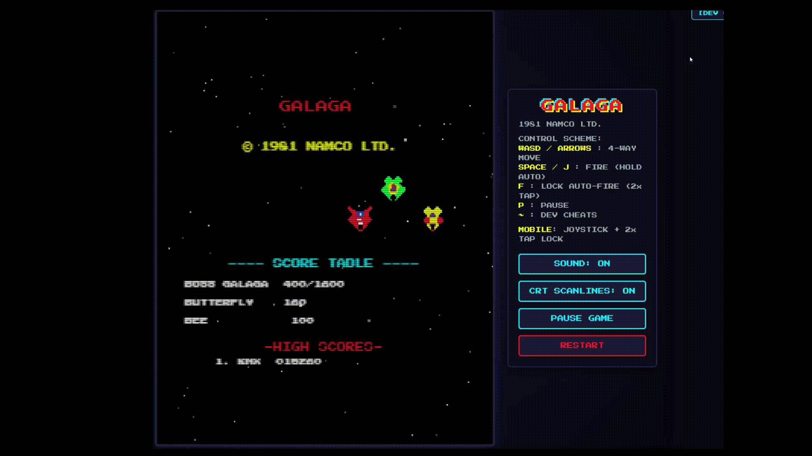

# 🚀 GALAGA 1981 — Vibe Coding Edition 👾

> **A retro arcade game inspired by the legendary 8-bit classic Galaga (1981).**  
> *My first vibe coding project built paired with the Antigravity AI coding assistant!* 🕹️✨

[](https://www.typescriptlang.org/)
[](https://vitejs.dev/)
[](https://developer.mozilla.org/)
[](https://TierK.github.io/galaga/)

---

### 🕹️ [▶️ PLAY ONLINE NOW (GitHub Pages)](https://TierK.github.io/galaga/)
> 🌐 **Live Demo:** Deployed and hosted directly on **GitHub Pages**! Playable instantly in any web browser on desktop or mobile — zero install required:  
> 👉 **[https://TierK.github.io/galaga/](https://TierK.github.io/galaga/)**

---

## 📸 Gameplay Preview

<p align="center">
  <a href="https://TierK.github.io/galaga/">
    
  </a>
  <br>
  <em>(Click on the preview to play the game live on GitHub Pages!)</em>
</p>

---

## ✨ Features

- 🛸 **Authentic 1981 Arcade Mechanics**:
  - Curved enemy entry paths (cubic and quadratic Bezier curves);
  - Breathing squadron formation (Zako, Goei, and Boss Galaga);
  - Dive-bombing swoop attacks with escorts;
  - **Tractor Beam**: Boss Galaga swoops down to capture player ship;
  - Rescue captive fighter to dock side-by-side into the iconic **Dual Fighter** (2x parallel laser firepower);
  - Target-practice **Challenging Stages** every 4 waves with accuracy evaluations.
- 🎨 **100% Procedural Pixel Art**:
  - Every sprite, explosion particle, and stage badge is rendered from embedded pixel matrices (zero external image dependencies, zero loading delays).
- 🔊 **Dynamic Web Audio API Synthesizer**:
  - Laser fires, dive sirens, tractor beam resonance hum, explosions, and retro fanfares synthesized in real time via oscillator nodes and envelopes.
- 🎮 **Cross-Platform Controls**:
  - **Desktop**: `WASD` / Arrow keys (4-way flight), `Space` / `J` to shoot, hold for auto-fire, `F` key to lock continuous auto-fire, `P` for pause.
  - **Android / Mobile Touch**: Smooth virtual thumbstick on the left + large tactile `FIRE` button on the right. **Double-tap (`2x Tap`)** on the `FIRE` button locks automatic firing (`AUTO [LOCK]`).
- 🛡️ **Respawn Protection**: 3 seconds of invulnerability upon spawning with instant movement control.
- 🛠️ **Developer Cheats Drawer**: Toggleable via `[DEV CHEATS]` button or `` ` `` / `~` key (test tractor beam capture, force dual fighter, skip stages, god mode).

---

## 🕹️ Controls

| Action | Desktop Keyboard | Mobile / Tablet Touch |
|---|---|---|
| Movement (4-Way) | `W`, `A`, `S`, `D` or `←`, `↑`, `↓`, `→` | Virtual Joystick (Left) |
| Fire Missile | `Space` or `J` (Hold for auto-fire) | `FIRE` Button (Hold for auto-fire) |
| Lock Auto-Fire | `F` Key | Double-Tap (`2x Tap`) on `FIRE` |
| Pause / Resume | `P` or `Esc` | `PAUSE` Button |
| Dev Cheats Drawer | `~` (Tilde) | `[DEV CHEATS]` Button (Top Right) |

---

## 🚀 Quick Start (Local Setup)

Requires [Node.js](https://nodejs.org/) (v18 or newer).

```bash
# 1. Clone repository
git clone https://github.com/TierK/galaga.git
cd galaga

# 2. Install dependencies
npm install

# 3. Start development server
npm run dev
```

Open your browser at: `http://localhost:3000/`.

---

## 🌐 Deployment (Play Online Anywhere)

### Option 1: GitHub Pages (Recommended Free Hosting)
1. In `vite.config.ts`, `base: './'` is already configured for static relative paths.
2. Build production bundle:
   ```bash
   npm run build
   ```
3. Push `main` to GitHub, go to your repository:  
   **Settings ➔ Pages ➔ Source** and select **GitHub Actions** (or deploy the `dist` folder).
4. Your game will be live worldwide at: `https://TierK.github.io/galaga/`!

### Option 2: Docker Container
```dockerfile
# Dockerfile included in root
docker build -t galaga-game .
docker run -d -p 80:80 galaga-game
```
Deployable to any cloud server, Render, Railway, or VPS in seconds.

---

## 💾 High Scores & Persistence

- **Current Implementation**: Uses browser `localStorage` — high scores, hit/miss ratio, and 3-letter initials persist reliably across sessions with zero server latency.
- **Global Multiplayer Leaderboard**: Easily plug in a free cloud backend such as **Supabase** or **Firebase Firestore** with just a few lines of client-side code.

---

## 👨‍💻 Author & Vibe Coding

- Author: **TierK**
- Built in **Vibe Coding** mode powered by **Google Antigravity**.
- Inspired by the original 1981 arcade game by Namco.
